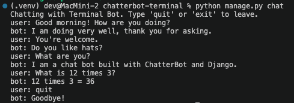

# ChatterBot Terminal Client

A terminal chatbot built with Python, Django, and [ChatterBot](https://chatterbot.readthedocs.io/en/stable/). Django supplies the database models, migrations, and management commands; ChatterBot supplies the machine-learning dialog engine that picks a response by matching your input against conversations it was trained on.

```
user: Good morning! How are you doing?
bot: I am doing very well, thank you for asking.
user: You're welcome.
bot: Do you like hats?
```

## Requirements

- Python 3.10 to 3.14
- The packages in `requirements.txt` (Django 5.2, ChatterBot 1.2.15, the ChatterBot corpus, PyYAML, and spaCy's English model)

## Setup

```bash
python3 -m venv .venv
source .venv/bin/activate          # Windows: .venv\Scripts\activate
pip install -r requirements.txt
python manage.py migrate           # creates db.sqlite3 with ChatterBot's tables
python manage.py train_bot         # optional: chat trains automatically on first run
```

## Usage

```bash
python manage.py chat
```

Type a message after `user:` and press Enter. Type `quit` or `exit` (or press Ctrl+C) to end the session.

| Command | What it does |
| --- | --- |
| `python manage.py chat` | Chat using the trained knowledge (read-only) |
| `python manage.py chat --learn` | Chat and save each new exchange as training data |
| `python manage.py train_bot` | Train on the English corpus and the custom conversations |
| `python manage.py train_bot --reset` | Clear everything learned, then retrain |

## How it works

1. **Storage.** `DjangoStorageAdapter` saves every known statement in Django's SQLite database through the `chatterbot.ext.django_chatterbot` app.
2. **Training.** `ChatterBotCorpusTrainer` reads `chat/training_data/custom_conversations.yml` first, then the ChatterBot English corpus (greetings, science, computers, humor, and more). Each line of a conversation is stored as the response to the line before it.
3. **Responding.** The `BestMatch` logic adapter finds the stored statement most similar to your input and returns a response that followed it during training. If nothing is at least 90% similar, the bot returns a default "I don't understand" message instead of guessing. `MathematicalEvaluation` handles simple arithmetic like "What is 12 times 3?"

## Project structure

```
manage.py                         Django command-line entry point
chatbot_project/settings.py       settings: installed apps, SQLite database, bot name
chat/bot.py                       builds and trains the ChatBot (shared by both commands)
chat/management/commands/chat.py  the terminal chat loop
chat/management/commands/train_bot.py  training command
chat/training_data/custom_conversations.yml  custom training conversations
requirements.txt                  pinned dependencies (manifest)
```

## Screenshot


